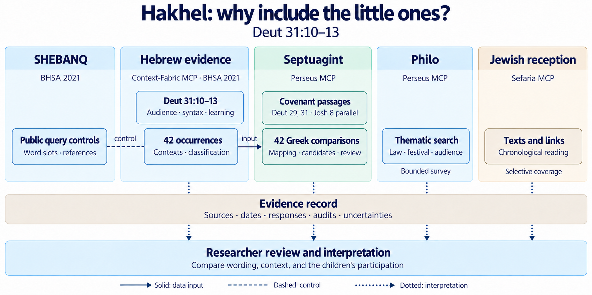

# Hakhel

A [web overview](https://tonyjurg.github.io/Hakhel/) introduces the research and links to the six notebooks.

This repository investigates the explicit inclusion of טַף (*ṭap̄*), the “little ones,” in the Hakhel command in Deut 31:10–13.
The central question is why the children are assembled with the men, women, and resident foreigner, and what their presence means for hearing, learning, and participation in the community.

The notebooks approach this question through the Hebrew text, the Greek translations, Philo, and later Jewish interpretation.
They keep the retrieved source material separate from the proposed readings and classifications.

The Septuagint and Philo notebooks use [Perseus MCP](https://tonyjurg.github.io/Perseus-mcp/) to search and retrieve Greek texts.
The recorded runs use version 1.0.2 ([DOI](https://doi.org/10.5281/zenodo.20931139)).
A descriptive document on Perseus MCP is available at [doi:10.5281/zenodo.23664266](https://doi.org/10.5281/zenodo.23664266).

Context-Fabric is described in Cody Kingham’s [“Carrying Text-Fabric Forward: Context-Fabric and the Scalable Corpus Ecosystem”](https://github.com/Context-Fabric/context-fabric/blob/master/docs/intro-to-cf/intro-to-cf.pdf) (January 2026).

The Hebrew word is transliterated as *ṭap̄* throughout the explanatory text; filenames use the plain spelling `taf`.

## Table of contents (ToC)

* <a href="#bullet1">1 - The notebooks</a>
* <a href="#bullet2">2 - Suggested reading order</a>
* <a href="#bullet3">3 - Running the notebooks</a>
* <a href="#bullet4">4 - Data and interpretation</a>
* <a href="#bullet5">5 - Responsible disclosure</a>
* <a href="#bullet6">6 - Sources and reuse</a>

# 1 - The notebooks
##### [Back to ToC](#TOC)

| Notebook | Purpose |
|---|---|
| [Context-Fabric / BHSA](context_fabric/hakhel_bhsa.ipynb) | Investigates Deut 31:10–13 and retrieves all 42 occurrences of טף in BHSA 2021, with a separate contextual classification. |
| [Public SHEBANQ queries](SHEBANQ-BHSA/shebanq_controls.ipynb) | Reads five public query records and compares their recorded all-טף word slots with the Context-Fabric export. |
| [The main Septuagint passages](lxx/hakhel_lxx.ipynb) | Examines the Greek audience descriptions in Deut 29, Deut 31, and the Joshua covenant-reading parallel. |
| [The 42 Hebrew–Greek comparisons](lxx/taf_lxx_alignment.ipynb) | Uses the Context-Fabric occurrence table to retrieve Greek passages, suggest lexical candidates, and identify cases for review. |
| [Philo](philo/hakhel_philo.ipynb) | Searches the available Greek texts for passages about the festival, reading and hearing the law, and the assembled community. |
| [Jewish reception history](reception_history/hakhel_reception.ipynb) | Retrieves Sefaria search results, links, and texts, and places selected witnesses in a curated chronological reading table. |

The directory guides describe the methods, setup, outputs, and limits in more detail: [Context-Fabric](context_fabric/README.md), [SHEBANQ](SHEBANQ-BHSA/README.md), [Septuagint](lxx/README.md), [Philo](philo/README.md), and [reception history](reception_history/README.md).

# 2 - Suggested reading order
##### [Back to ToC](#TOC)

The diagram shows how the retrieval routes contribute to the recorded evidence and the final interpretation.

Start with the Context-Fabric notebook for the Hebrew evidence and the range of contexts in which טף occurs.
The SHEBANQ notebook checks the retrieved references and word slots through another access route to the same BHSA corpus.

Then read the main Septuagint passages before moving to the 42-row comparison.
That comparison uses the Context-Fabric CSV as its Hebrew input, so run the Context-Fabric notebook first if the export is missing or needs updating.
Hebrew and Greek verse numbering sometimes differ; the Greek candidates remain proposals for close reading.

The Philo notebook explores related themes without assuming that a keyword hit is a reference to Hakhel.
The reception-history notebook follows later readings of the children's presence, including adult merit, formation, direct reception, and intergenerational participation.

# 3 - Running the notebooks
##### [Back to ToC](#TOC)

For a fresh setup, follow [Reproducing the Hakhel notebooks](REPRODUCING.md).
Use the setup instructions for the notebook you want to run.
The directories have different dependencies and data sources; one environment is not assumed to serve them all.

* **Context-Fabric** uses a local BHSA 2021 checkout and an MCP server at `http://127.0.0.1:8765/sse`.
The startup script defaults to the Anaconda `context_fabric` environment.
Its pinned server requires Python 3.13 or later and `mcp==1.30.0`.
* **SHEBANQ** reads public metadata and recorded query results over HTTP. It requires network access but no account.
Start its kernel in `SHEBANQ-BHSA`.
* **Septuagint and Philo** use the local `perseus-mcp` package through an MCP client.
Text retrieval requires network access to the Perseus/Scaife services.
Start the Philo kernel in `philo` so its relative output path stays there.
* **Reception history** uses Sefaria's hosted MCP endpoint. Running all cells creates a new dated run containing its own raw responses, tables, and audit.

Run each notebook from the first cell so its paths, helper functions, and data are available to later cells.
Check the final audit and any review tables; a completed execution can still contain failed retrievals or unresolved cases.

# 4 - Data and interpretation
##### [Back to ToC](#TOC)

The exported tables and run summaries record the retrieved evidence.
Local BHSA files and compiled caches are kept outside version control.
Public services and search indexes can change, so later executions may return different results.

The reception-history directory identifies its current run in [`results/current_run.json`](reception_history/results/current_run.json).
The current run's audit retains its retrieval failures and search-limit warnings.

Contextual frames, working translations, Greek alignment candidates, and the curated reception-history readings require interpretation.
They are not values supplied by BHSA, Perseus, or Sefaria.
The notebook notes describe the role of AI assistance and researcher review.
Search hits help locate evidence; they do not establish a historical connection on their own.
Where wording, textual variants, or dating matter, check the passage against an appropriate edition.

# 5 - Responsible disclosure
##### [Back to ToC](#TOC)

The author used OpenAI Codex to assist with Python code and data analysis, and OpenAI image generation to prepare the [overview diagram](images/overview.png).
The author reviewed and edited the material and takes responsibility for the content and interpretation.

# 6 - Sources and reuse
##### [Back to ToC](#TOC)

The project’s own code is licensed under the [MIT License](LICENSE).
Its original research writing and explanatory text are licensed under [CC BY 4.0](https://creativecommons.org/licenses/by/4.0/); see the [text licence](LICENSE-TEXT.md).
These licences cover the author’s own contributions; source texts and datasets retain their separate terms.

The source datasets have different reuse terms.
BHSA data is CC BY-NC 4.0; the checked First1KGreek editions are CC BY-SA 4.0; Sefaria text rights depend on the version.
See [Sources, attribution, and reuse](DATA_RIGHTS.md) for the source notices, attribution requirements, and unresolved checks.
